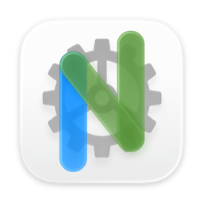

# Neovide macOS Icon

A custom Neovide icon designed with Apple Icon Composer and compiled directly to ICNS using Xcode’s `actool`.

## Preview



The preview is converted from the included `neovide.icns`, preserving its transparent background.

## Files

- `neovide.icon`: Icon Composer source.
- `neovide.icns`: Compiled icon.
- `preview.png`: Preview image used in this README.
- `build.sh`: Build script.

## Usage

Download [neovide.icns](neovide.icns) and save it to a permanent location.

Add the following top-level setting to `$HOME/.config/neovide/config.toml` (before any TOML section headers), replacing the placeholder with the absolute path to the downloaded file:

```toml
icon = "<path to>/neovide.icns"
```

If an `icon` setting already exists, update it instead of adding a duplicate. Restart Neovide to apply the icon.

## Build

Requires macOS and a full Xcode installation that supports the source `.icon` format. Complete Xcode’s first-launch setup and accept its license agreement before building. Command Line Tools alone are not sufficient.

Run from this directory:

```bash
./build.sh
```

The script automatically selects the only `.icon` file next to it and creates an `.icns` file with the same name alongside the source. It preserves the output from `xcrun actool` without resizing, filtering image sizes, or repacking.

The script stops if the output already exists. To keep an existing build, specify a different output filename:

```bash
./build.sh neovide.icon neovide-new.icns
```

For Xcode installed on an external drive or in a custom location, set `DEVELOPER_DIR`:

```bash
DEVELOPER_DIR="/Volumes/SANDISK/Applications/Xcode.app/Contents/Developer" \
  ./build.sh neovide.icon neovide-new.icns
```

No Xcode project or app is required.

## Update the Preview

After updating `neovide.icns`, run from this directory:

```bash
sips -s format png neovide.icns --out preview.png
```

This generates the preview PNG without modifying the ICNS file.
